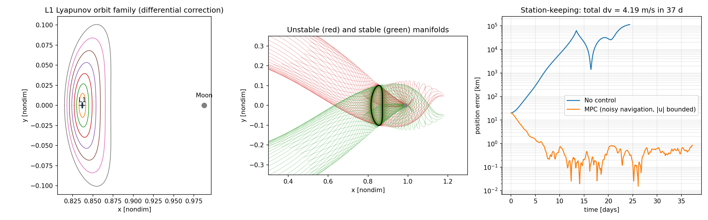

# Earth-Moon L1: Lyapunov orbits, invariant manifolds and MPC station-keeping

Self-study project in the planar circular restricted three-body problem (CR3BP), following Prof. Shane Ross's astrodynamics lectures.



## What it does
1. **Lagrange points.** Collinear points L1, L2, L3 by root finding on the effective potential.
2. **Lyapunov orbit family around L1.** Initial guess from the center eigenvector of the linearized dynamics, then single-shooting differential correction with the state transition matrix (symmetric orbits, vx = 0 at the half-period x-axis crossing), plus natural-parameter continuation in amplitude.
3. **Invariant manifolds.** Stable and unstable eigenvectors of the monodromy matrix, transported along the orbit with the STM and propagated backward and forward in time.
4. **Station-keeping with linear MPC.** Linear time-varying model of the deviation dynamics along the periodic reference (one-step STM), quadratic cost, bounded acceleration (|u|inf <= 2e-4 m/s^2), noisy navigation (1 km, 1 cm/s), 20 km and 5 cm/s injection error. The true plant is the nonlinear CR3BP.

## Results (default run)
| Quantity | Value |
| --- | --- |
| L1 distance from the Moon | ~58,000 km |
| Small-amplitude Lyapunov period | ~11.7 days |
| Unstable monodromy eigenvalue | ~1800 (deviation grows ~1800x per period) |
| Uncontrolled | leaves the orbit in ~3 weeks |
| MPC | error from 20 km to ~1 km (navigation-noise floor), ~4 m/s over ~37 days |

## Run
```
pip install numpy scipy matplotlib cvxpy
python reference/cr3bp_l1_mpc.py
```

## Limitations
Planar model only, no solar perturbation, simplified ZOH input discretization, and a navigation-noise model without a filter. Natural next steps: halo orbits (spatial CR3BP), an EKF in the loop, and chance-constrained MPC.
